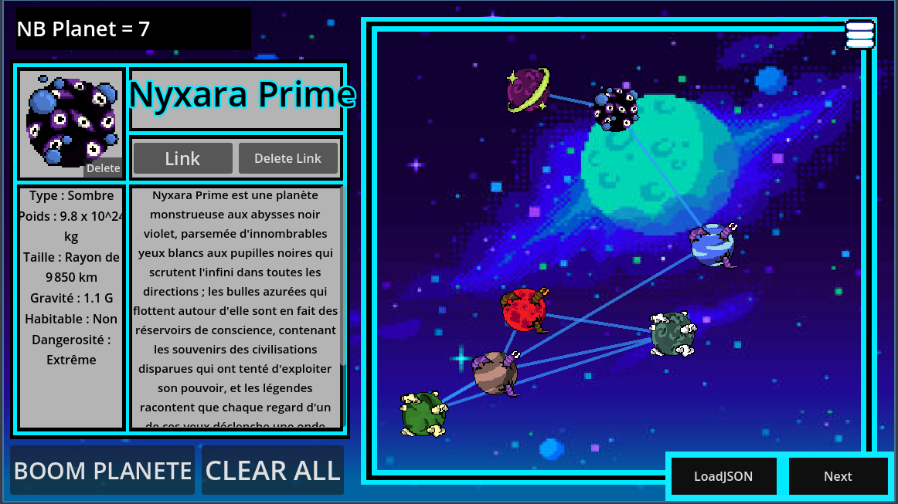
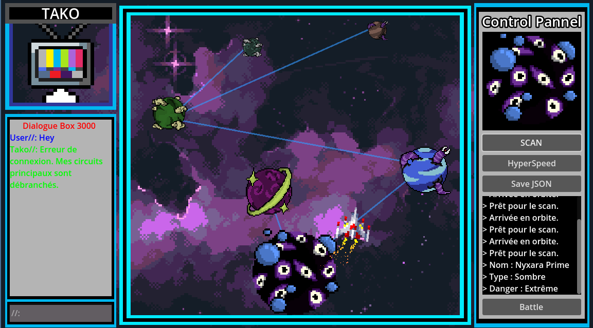

# Tako Space

> Jeu d'exploration spatiale en **Godot 4.5**, propulsé par un serveur **Python (Flask)** et un LLM (**gpt-oss-120b via Groq**).
> Les planètes sont générées par l'IA, reliées entre elles dans un **graphe galactique**, puis explorées avec les algorithmes **BFS** et **DFS**, sous le regard de **Tako**, l'IA de bord.

Projet réalisé dans le cadre du cours **Python S4 – ESEO 2025/2026** (projet fil rouge sur les graphes).




---

## Ce que fait le projet

- **Création de planètes** : Godot envoie l'apparence choisie au serveur, qui demande au LLM de générer le nom, le type et le lore de la planète au format JSON. Les noms déjà utilisés sont interdits pour éviter les doublons.
- **Graphe galactique** : les planètes sont des nœuds, les routes spatiales des arêtes (création et suppression de liens).
- **Radar (BFS)** : parcours en largeur depuis la planète courante, jusqu'à 3 sauts, pour afficher les planètes proches par rang d'éloignement.
- **Route hyperespace (DFS)** : calcul d'un chemin entre deux planètes avec le parcours en profondeur.
- **Tako, l'IA de bord** : un assistant conversationnel avec sa personnalité (froide, administrative), qui répond au joueur via le LLM.
- **Sauvegarde** : l'état de l'univers est exporté en fichiers JSON.

## Architecture

```
┌──────────────┐   HTTP / JSON    ┌───────────────────┐    API    ┌──────────┐
│  Godot 4.5   │ ───────────────► │  Serveur Flask    │ ────────► │  Groq    │
│  (client)    │ ◄─────────────── │  Tako/ (port 8000)│ ◄──────── │  gpt-oss │
└──────────────┘                  └─────────┬─────────┘           └──────────┘
                                            │
                                  Graph + BFS / DFS
                                  (modules Python du projet)
```

Routes du serveur : `/analyse`, `/link`, `/unlink`, `/neighbors`, `/radar`, `/set_current_planet`, `/hyperspeed_route`, `/chat`, `/clear`, `/save_graph`, `/get_graph`.

## Installation

**Prérequis** : Python 3.10+, [Godot 4.5](https://godotengine.org/), une clé API [Groq](https://console.groq.com/).

```bash
# 1. Récupérer le projet
git clone https://github.com/Trilord1234/ESEO_Projet_E2.git
cd ESEO_Projet_E2

# 2. Installer les dépendances Python
pip install -r requirements.txt

# 3. Configurer la clé API (ce fichier est ignoré par Git)
cp Tako/TakoAPIKey.example.py Tako/TakoAPIKey.py
#    puis ouvrir Tako/TakoAPIKey.py et y mettre votre clé

# 4. Lancer le serveur (laissez-le tourner)
python Tako/Serveur_Tako_Space.py
```

Ensuite, ouvrir `Godot/projet-info/project.godot` dans Godot 4.5 et lancer le jeu (**F5**). Le client communique avec le serveur sur `http://127.0.0.1:8000`.

> Sous Windows PowerShell, remplacer `cp` par `copy`.

## Tests

Les modules de graphe et les algorithmes sont couverts par **83 tests** :

```bash
python -m pytest
```

## Structure du dépôt

```
.
├── Godot/projet-info/   Client du jeu (scènes, scripts GDScript, assets)
├── Tako/                Serveur Flask + IA (Groq)
├── src/app/             Modules Python : graphe, algorithmes (BFS, DFS), entrées/sorties
├── tests/               Tests unitaires (pytest)
├── docs/                Sujet du projet et guide Git
└── requirements.txt
```

## Équipe

- [Trilord (Me)](https://github.com/Trilord1234)
- [FatihhanCog (Friend)](https://github.com/FatihhanCog)


## Crédits

- Squelette du projet, sujet et tests fournis par l'équipe pédagogique de l'ESEO ([dépôt d'origine](https://github.com/JustincGuechi/PythonS4ESEO_2025_2026)).
- [Godot Engine](https://godotengine.org/) pour le client de jeu.
- [Groq](https://groq.com/) et le modèle gpt-oss-120b d'OpenAI pour la génération de texte.
- **Pixel art** (planètes, Tako, boutons, interface) : créé par l'équipe du projet.
- **Fonds d'écran et vaisseau** : ressources tierces (sources exactes perdues depuis la fin du projet, propriété de leurs auteurs originaux).
- **Musique du jeu** : [*Black Souls 2 Soundtrack - Card game*](https://youtu.be/qFKGALOHtwM?si=5j53tZO5m1SvtaV0) (OST du jeu développé par Toro). Propriété de ses ayants droit.

## Licence

© 2026 Trilord1234. Tous droits réservés, hors ressources tierces
(fonds d'écran, vaisseau et musique : voir Crédits, qui restent la propriété de leurs auteurs).
Ce dépôt est public pour consultation. Toute reproduction, modification ou redistribution nécessite l'accord écrit des auteurs.
Retrait des ressources tierces sur simple demande.
